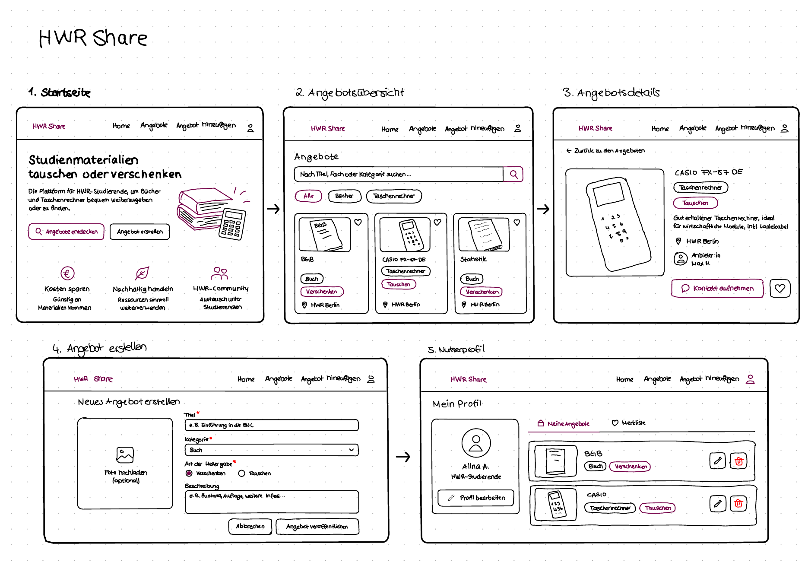

[← Documentation Home](README.md)

# Value Proposition – HWR Share & Swap

## Zielgruppen und ihre Probleme

HWR Share & Swap ist eine geplante Plattform für Studierende der HWR Berlin. Sie soll es ermöglichen, Studienmaterialien kostenlos zu tauschen, zu teilen oder zu verschenken.

Die Plattform richtet sich an zwei Zielgruppen: Studierende, die Lernmaterialien benötigen, und Studierende, die Materialien anbieten möchten.

### Nachfrageseite: Studierende, die Lernmaterialien suchen

Viele Studierende benötigen für ihr Studium Bücher, Taschenrechner, Mitschriften oder andere Lernmaterialien. Diese können teuer sein, besonders wenn sie nur für ein Semester gebraucht werden.

Deshalb suchen Studierende nach einer einfachen und kostenlosen Möglichkeit, passende Materialien von anderen Studierenden zu bekommen.

### Angebotsseite: Studierende, die Lernmaterialien anbieten

Viele Studierende besitzen Bücher, Mitschriften oder andere Studienmaterialien, die sie nicht mehr benötigen.

Anstatt diese wegzuwerfen oder ungenutzt aufzubewahren, möchten sie die Materialien an andere Studierende weitergeben oder tauschen.

Oft wissen sie jedoch nicht, wer diese Materialien gebrauchen könnte oder wie sie interessierte Personen erreichen können.

## Unsere Plattformlösung

HWR Share & Swap soll Studierende miteinander verbinden, die Lernmaterialien suchen oder anbieten möchten.

Über die Plattform sollen Materialien kostenlos getauscht, geteilt oder verschenkt werden können. Kaufen und Verkaufen sind nicht vorgesehen.

Unser Ziel ist es, Studierende finanziell zu entlasten, Ressourcen nachhaltiger zu nutzen und den Austausch innerhalb der Hochschule zu fördern.

### Lösung für die Nachfrageseite

Studierende sollen auf der Plattform verfügbare Lernmaterialien durchsuchen können.

Sie sollen Informationen zu den angebotenen Materialien erhalten und die anbietende Person kontaktieren können.

Dadurch können sie Geld sparen und benötigte Lernmaterialien einfacher finden.

### Lösung für die Angebotsseite

Studierende sollen eigene Angebote erstellen können, wenn sie Materialien nicht mehr benötigen.

Sie sollen ihre Materialien beschreiben und anderen Studierenden zur Verfügung stellen können.

Dadurch können ungenutzte Materialien weiterverwendet werden, anstatt weggeworfen zu werden.

## Happy Paths – Geplante Nutzerabläufe

Die folgenden Abläufe beschreiben, wie die Plattform später funktionieren soll. Da sich die Anwendung noch in der Planungsphase befindet, können sich einzelne Schritte während der Entwicklung ändern.

### Happy Path der Nachfrageseite

1. Eine studierende Person öffnet HWR Share & Swap.
2. Sie durchsucht die verfügbaren Lernmaterialien.
3. Sie findet ein interessantes Angebot.
4. Sie öffnet die Detailansicht des Materials.
5. Sie kontaktiert die Person, die das Material anbietet.
6. Beide vereinbaren eine Übergabe oder einen Tausch.
7. Das Material wird erfolgreich weitergegeben.

### Happy Path der Angebotsseite

1. Eine studierende Person öffnet HWR Share & Swap.
2. Sie entscheidet sich, ein nicht mehr benötigtes Lernmaterial anzubieten.
3. Sie erstellt ein Angebot mit einer Beschreibung des Materials.
4. Das Angebot wird für andere Studierende sichtbar.
5. Eine interessierte Person meldet sich.
6. Beide vereinbaren eine Übergabe oder einen Tausch.
7. Das Material wird erfolgreich weitergegeben.

---

## Initial Target Scope – Geplanter Funktionsumfang

Die UI-Skizzen zeigen, wie wir uns den Aufbau und die Bedienung von HWR Share & Swap vorstellen.

Für die Plattform sind zunächst folgende Bildschirme geplant:

- **Startseite:** Vorstellung der Plattform und ihrer wichtigsten Funktionen.
- **Materialübersicht:** Anzeige der verfügbaren Lernmaterialien.
- **Detailansicht:** Genauere Informationen zu einem ausgewählten Material.
- **Angebot erstellen:** Formular, mit dem Studierende eigene Materialien anbieten können.
- **Benutzerprofil:** Übersicht über persönliche Informationen und eigene Angebote.

Die folgenden UI-Skizzen veranschaulichen den geplanten Aufbau und die Navigation der Anwendung.

