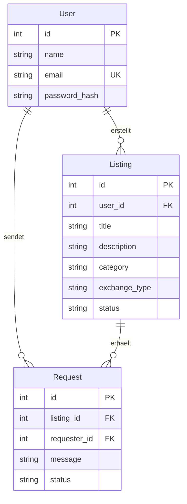

[← Documentation Home](README.md)

# Datenmodell

## Überblick

Unsere Plattform verbindet Studierende der HWR Berlin, die gebrauchte Lernmaterialien anbieten oder suchen möchten.

Das Datenmodell besteht aus drei zentralen Entitäten: **User (Benutzer), Listing (Anzeige) und Request (Anfrage)**.

Die Entität User speichert die Informationen der registrierten Studierenden. Die Entität Listing repräsentiert angebotene Lernmaterialien wie Bücher oder Taschenrechner, die verschenkt oder getauscht werden können. Die Entität Request stellt Anfragen von Studierenden dar, die an einer bestimmten Anzeige interessiert sind.

Ein Benutzer kann sowohl als Anbieter (Supply Side) als auch als Suchender (Demand Side) auftreten.

## Entity-Relationship-Diagramm

## Entitäten und Beziehungen

Die Entität User repräsentiert die registrierten Studierenden der HWR Berlin. Jeder Benutzer kann eigene Anzeigen erstellen und Anfragen zu Lernmaterialien anderer Studierender senden.

Die Entität Listing speichert Informationen über verfügbare Lernmaterialien. Jede Anzeige gehört zu einem Benutzer und beschreibt einen angebotenen Gegenstand, dessen Kategorie sowie die Art des Angebots – ob kostenlos abgegeben oder gegen einen anderen Gegenstand getauscht werden soll.

Die Entität Request verbindet einen interessierten Studierenden mit einer bestimmten Anzeige. Dadurch können Anbieter die Anfragen anderer Studierender verwalten.

Zusammen ermöglichen diese drei Entitäten den Austausch von Lernmaterialien zwischen den beiden Nutzergruppen.

## Zugehörige Designentscheidungen

Wichtige Entscheidungen zur Datenbankstruktur, zu den Benutzerrollen und zu den Beziehungen zwischen den Entitäten werden in separaten Design-Decision-Dokumenten festgehalten und hier verlinkt.

(Muss noch überarbeitet werden nach der Implementierung)