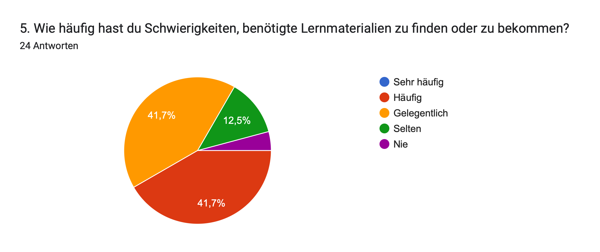
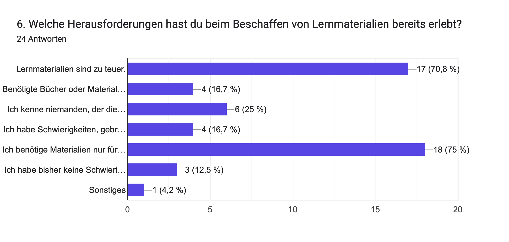
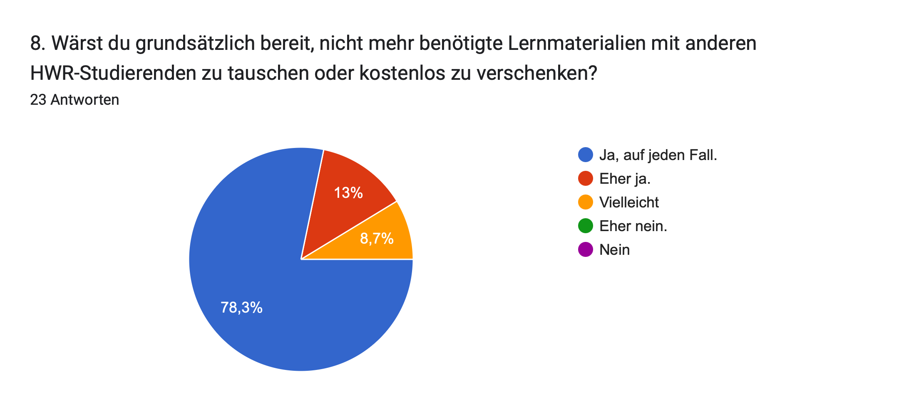
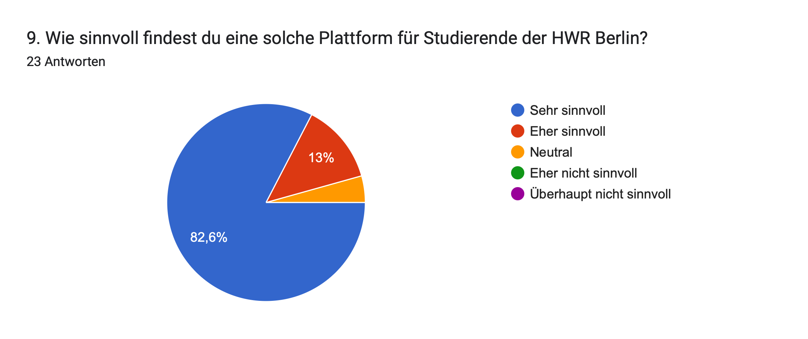

[← Product Discovery](README.md)

# Design Challenge – HWR Share

## Unsere Design Challenge

**Wie können wir Studierenden der HWR Berlin dabei helfen, benötigte Lernmaterialien leichter zu finden und nicht mehr benötigte Materialien einfach untereinander zu tauschen oder kostenlos zu verschenken?**

## Hintergrund und Problemstellung

Studierende benötigen während ihres Studiums unterschiedliche Lernmaterialien, beispielsweise Fachbücher, Taschenrechner oder Skripte. Einige dieser Materialien werden nur für einzelne Module oder Semester gebraucht und anschließend nicht mehr verwendet.

Gleichzeitig kann die Anschaffung neuer Lernmaterialien mit hohen Kosten verbunden sein. Studierende wissen außerdem nicht immer, welche Materialien andere Studierende bereits besitzen und weitergeben würden.

Unsere Idee ist deshalb, eine kostenlose Plattform speziell für Studierende der HWR Berlin zu entwickeln, die das Finden und Weitergeben gebrauchter Lernmaterialien erleichtert.

## Erkenntnisse aus unserer Umfrage

Um herauszufinden, ob dieses Problem tatsächlich besteht, haben wir eine anonyme Umfrage unter Studierenden durchgeführt. Je nach Frage liegen bis zu **24 Antworten** vor.

Die bisherigen Ergebnisse zeigen:

- **70,8 % (17 von 24)** nennen hohe Kosten für Lernmaterialien als Herausforderung.
- **75 % (18 von 24)** geben an, bestimmte Lernmaterialien nur für einen kurzen Zeitraum zu benötigen.
- **83,3 % (20 von 24)** haben häufig oder gelegentlich Schwierigkeiten, benötigte Lernmaterialien zu finden oder zu bekommen.
- **91,3 % (21 von 23)** wären grundsätzlich bereit, nicht mehr benötigte Lernmaterialien zu tauschen oder kostenlos zu verschenken.
- **95,7 % (22 von 23)** finden eine solche Plattform sehr oder eher sinnvoll.

Diese Ergebnisse deuten darauf hin, dass unter den befragten Studierenden Interesse an einer einfachen Möglichkeit zum Austausch von Lernmaterialien besteht.

Da die Umfrage nur eine begrenzte Anzahl an Teilnehmenden umfasst, sind die Ergebnisse nicht repräsentativ für alle Studierenden der HWR Berlin. Sie liefern jedoch erste Hinweise auf relevante Probleme und Bedürfnisse unserer Zielgruppe.

## Ziel unserer Design Challenge

Mit HWR Share möchten wir eine zentrale, kostenlose Plattform schaffen, auf der HWR-Studierende:

- verfügbare Lernmaterialien einfach suchen und finden können,
- nicht mehr benötigte Lernmaterialien anbieten können,
- Materialien miteinander tauschen oder kostenlos verschenken können,
- über einen integrierten Chat Kontakt aufnehmen und eine Übergabe vereinbaren können.

Dabei stehen eine übersichtliche Gestaltung und eine möglichst unkomplizierte Nutzung im Vordergrund.

## Raw Material – Verwendete Materialien

Als Grundlage für unsere Design Challenge haben wir eine anonyme Online-Umfrage mit 12 Fragen unter Studierenden durchgeführt.

Die folgenden Diagramme zeigen ausgewählte Ergebnisse, die für unsere Problemstellung und die Entwicklung von HWR Share relevant sind.

### Frage 5 – Schwierigkeiten beim Beschaffen von Lernmaterialien

### Frage 6 – Herausforderungen beim Beschaffen von Lernmaterialien

### Frage 8 – Bereitschaft zum Tauschen oder Verschenken

### Frage 9 – Bewertung der Plattformidee

## Fazit

Unsere Umfrage liefert erste Hinweise darauf, dass unter den befragten Studierenden Bedarf und Interesse an einer kostenlosen Plattform zum Tauschen und Verschenken von Lernmaterialien bestehen.

Besonders die hohen Anschaffungskosten und die häufig nur kurzfristige Nutzung von Lernmaterialien unterstützen unsere Entscheidung, HWR Share zu entwickeln.

Mit unserer Plattform möchten wir eine einfache Möglichkeit schaffen, vorhandene Lernmaterialien innerhalb der HWR Berlin weiterzugeben und dadurch Kosten und Ressourcen zu sparen.
