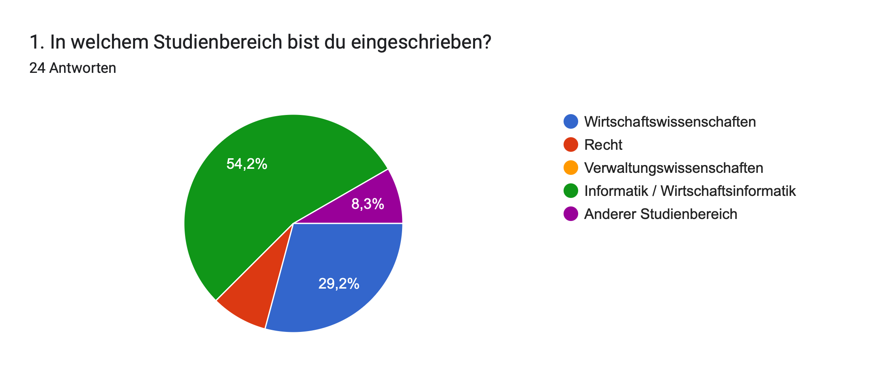
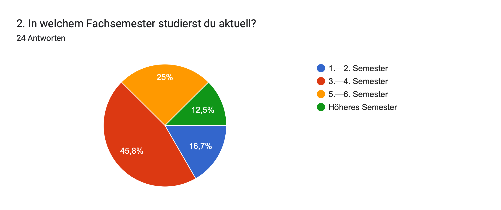
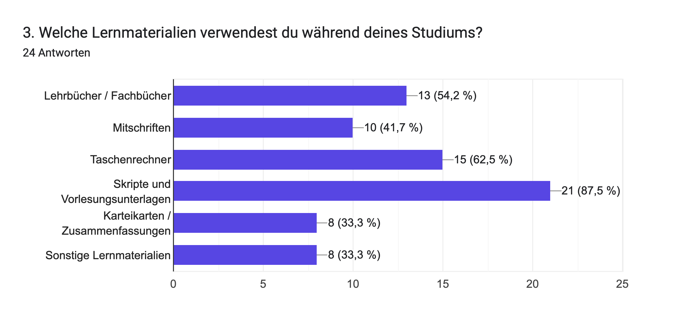
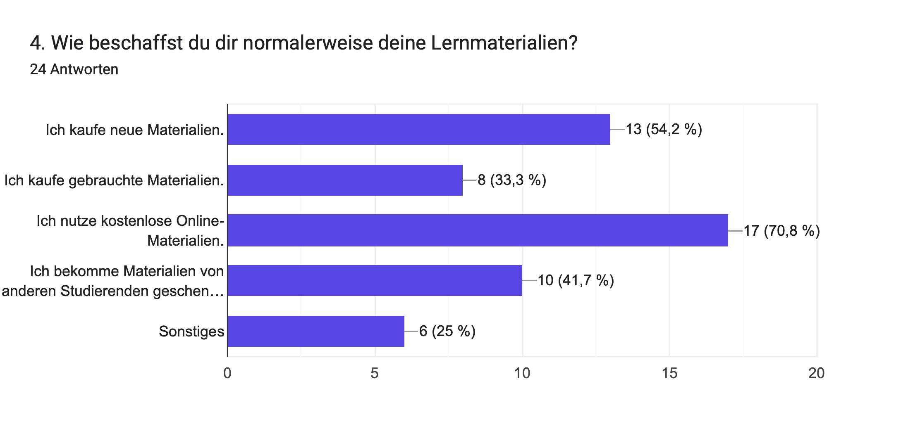
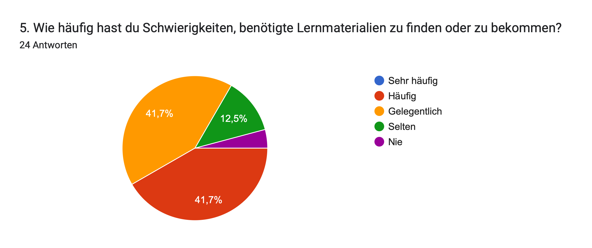
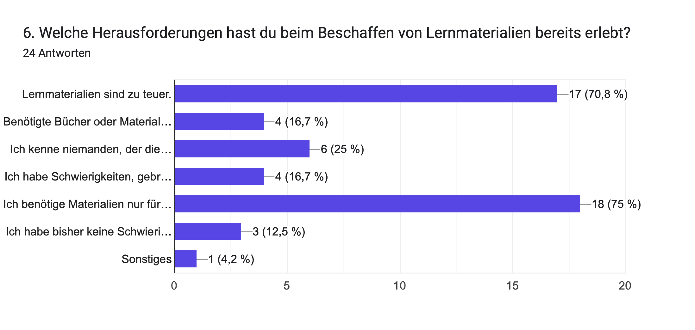
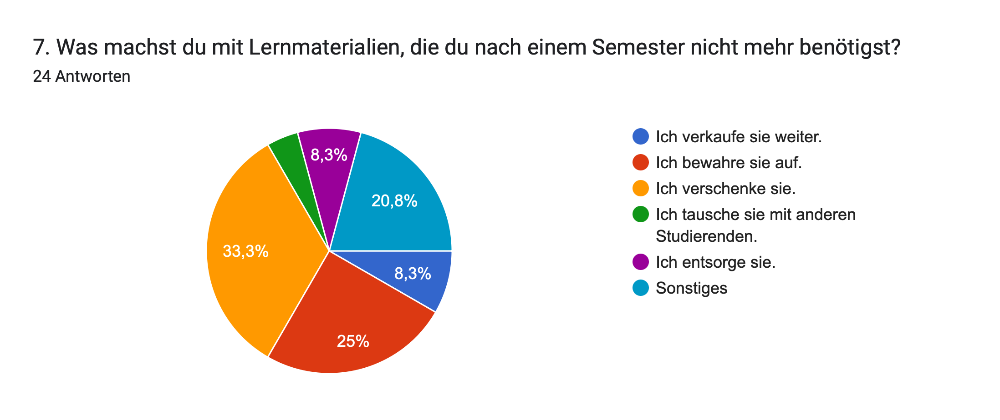

[← Product Discovery](README.md)

# Users & Problems – HWR Share

## Unsere Zielgruppe

Die Zielgruppe von HWR Share sind Studierende der Hochschule für Wirtschaft und Recht Berlin (HWR Berlin), die während ihres Studiums Lernmaterialien benötigen oder nicht mehr benötigte Materialien weitergeben möchten.

Dazu gehören insbesondere:

- Studierende, die nach günstigen oder kostenlosen Lernmaterialien suchen.
- Studierende, die bestimmte Materialien nur für ein Semester oder ein Modul benötigen.
- Studierende, die ihre nicht mehr benötigten Lernmaterialien tauschen oder verschenken möchten.
- Studierende, die andere HWR-Studierende mit passenden Lernmaterialien finden möchten.

Unsere Plattform richtet sich grundsätzlich an Studierende verschiedener Studiengänge und Fachsemester.

## Erkenntnisse über unsere Nutzer

Um die Bedürfnisse unserer Zielgruppe besser zu verstehen, haben wir eine anonyme Online-Umfrage durchgeführt. Je nach Frage liegen bis zu 24 Antworten vor.

### Studienbereiche und Fachsemester

Von den 24 Befragten studieren:

- **54,2 % (13 von 24)** Informatik oder Wirtschaftsinformatik.
- **29,2 % (7 von 24)** Wirtschaftswissenschaften.
- **16,7 % (4 von 24)** in anderen Studienbereichen.

Die Teilnehmenden befinden sich in unterschiedlichen Fachsemestern. Die größte Gruppe bilden Studierende im dritten oder vierten Fachsemester mit **45,8 % (11 von 24)**.

Damit wurden Studierende aus verschiedenen Studienbereichen und Studienphasen erreicht. Die Umfrage ist allerdings nicht repräsentativ für die gesamte HWR Berlin.

### Verwendete Lernmaterialien

Die Befragten nutzen unterschiedliche Materialien während ihres Studiums:

- **87,5 % (21 von 24)** verwenden Skripte oder Vorlesungsunterlagen.
- **62,5 % (15 von 24)** verwenden Taschenrechner.
- **54,2 % (13 von 24)** verwenden Lehrbücher oder Fachbücher.
- **41,7 % (10 von 24)** verwenden Mitschriften.
- **33,3 % (8 von 24)** verwenden Karteikarten oder Zusammenfassungen.

Da bei dieser Frage mehrere Antworten möglich waren, ergeben die Prozentwerte zusammen mehr als 100 %.

Diese Ergebnisse zeigen, dass Studierende unterschiedliche Arten von Lernmaterialien benötigen. Deshalb soll HWR Share verschiedene Materialkategorien unterstützen.

## Probleme unserer Zielgruppe

### Problem 1 – Hohe Kosten für Lernmaterialien

Viele Studierende müssen während ihres Studiums Bücher, Taschenrechner oder andere Lernmaterialien beschaffen.

In unserer Umfrage nannten **70,8 % (17 von 24)** hohe Kosten als Herausforderung.

Besonders problematisch kann dies sein, wenn Materialien nur für einzelne Module oder Semester benötigt werden.

**Bedürfnis:** Studierende möchten benötigte Lernmaterialien möglichst kostengünstig oder kostenlos erhalten.

### Problem 2 – Schwierigkeiten bei der Beschaffung

Nicht immer ist es einfach, benötigte Lernmaterialien zu finden.

In unserer Umfrage gaben **83,3 % (20 von 24)** an, häufig oder gelegentlich Schwierigkeiten bei der Beschaffung zu haben.

Außerdem wissen Studierende möglicherweise nicht, wer bestimmte Materialien bereits besitzt und weitergeben möchte.

**Bedürfnis:** Studierende benötigen eine zentrale und übersichtliche Möglichkeit, verfügbare Lernmaterialien zu suchen und zu finden.

### Problem 3 – Lernmaterialien werden nur kurzfristig benötigt

Einige Lernmaterialien werden nur für ein bestimmtes Modul oder Semester verwendet.

**75 % (18 von 24)** der Befragten gaben an, bestimmte Lernmaterialien nur für einen kurzen Zeitraum zu benötigen.

Nach der Nutzung werden diese Materialien möglicherweise aufbewahrt, obwohl andere Studierende sie noch gebrauchen könnten.

**Bedürfnis:** Studierende möchten nicht mehr benötigte Lernmaterialien unkompliziert weitergeben können.

### Problem 4 – Fehlende direkte Verbindung zwischen Studierenden

Studierende wissen nicht immer, welche anderen HWR-Studierenden passende Lernmaterialien anbieten können.

In unserer Umfrage gaben **25 % (6 von 24)** an, dass sie niemanden kennen, der die benötigten Materialien besitzt.

Dadurch kann der Austausch zwischen Studierenden erschwert werden.

**Bedürfnis:** Studierende benötigen eine einfache Möglichkeit, passende Angebote zu entdecken und mit anderen Studierenden Kontakt aufzunehmen.

## Aktueller Umgang mit Lernmaterialien

Unsere Umfrage zeigt, dass Studierende ihre Lernmaterialien auf unterschiedliche Weise beschaffen.

Von 24 Befragten nutzen:

- **70,8 % (17 von 24)** kostenlose Online-Materialien.
- **54,2 % (13 von 24)** kaufen Lernmaterialien neu.
- **41,7 % (10 von 24)** erhalten Materialien von anderen Studierenden geschenkt oder geliehen.
- **33,3 % (8 von 24)** kaufen Materialien gebraucht.

Auch hier waren Mehrfachantworten möglich.

Auf die Frage, was mit nicht mehr benötigten Materialien passiert, antworteten unter anderem:

- **33,3 % (8 von 24)** verschenken sie.
- **25 % (6 von 24)** bewahren sie auf.
- **8,3 % (2 von 24)** verkaufen sie.
- **4,2 % (1 von 24)** tauschen sie.

Diese Ergebnisse zeigen, dass die Weitergabe von Lernmaterialien bereits stattfindet. HWR Share soll diesen Austausch innerhalb der Hochschule einfacher und übersichtlicher gestalten.

## Zentrale Nutzerbedürfnisse

Aus den Umfrageergebnissen und den beschriebenen Problemen leiten wir folgende Bedürfnisse ab:

1. **Kosten sparen:** Lernmaterialien kostenlos erhalten können.
2. **Materialien schnell finden:** Eine übersichtliche Suche und passende Kategorien nutzen können.
3. **Materialien weitergeben:** Nicht mehr benötigte Materialien unkompliziert anbieten können.
4. **Kontakt aufnehmen:** Mit anderen Studierenden direkt kommunizieren können.
5. **Einfachheit:** Die Plattform ohne großen Aufwand bedienen können.

Diese Bedürfnisse bilden die Grundlage für die weitere Entwicklung von HWR Share.

## Raw Material – Verwendete Materialien

Die Analyse unserer Zielgruppe und ihrer Probleme basiert auf der anonymen Umfrage „Lernmaterialien an der HWR Berlin“ mit 12 Fragen.

Die folgenden Diagramme dokumentieren ausgewählte Ergebnisse.

### Frage 1 – Studienbereich der Befragten

### Frage 2 – Fachsemester der Befragten

### Frage 3 – Verwendete Lernmaterialien

### Frage 4 – Beschaffung von Lernmaterialien

### Frage 5 – Schwierigkeiten bei der Beschaffung

### Frage 6 – Herausforderungen bei der Beschaffung

### Frage 7 – Umgang mit nicht mehr benötigten Lernmaterialien

## Fazit

Die Umfrage zeigt, dass die befragten HWR-Studierenden unterschiedliche Lernmaterialien benötigen und bei deren Beschaffung teilweise auf Schwierigkeiten stoßen.

Besonders die Kosten, die kurzfristige Nutzung bestimmter Materialien und die fehlende Verbindung zwischen anbietenden und suchenden Studierenden sind für unsere Projektidee relevant.

HWR Share soll diese Probleme aufgreifen, indem die Plattform das Suchen, Tauschen und kostenlose Verschenken von Lernmaterialien innerhalb der HWR Berlin ermöglicht.

Die Ergebnisse dienen als erste Orientierung für unsere Entwicklung. Ob die Plattform die Bedürfnisse tatsächlich erfüllt, muss später durch Tests mit Nutzenden überprüft werden.
