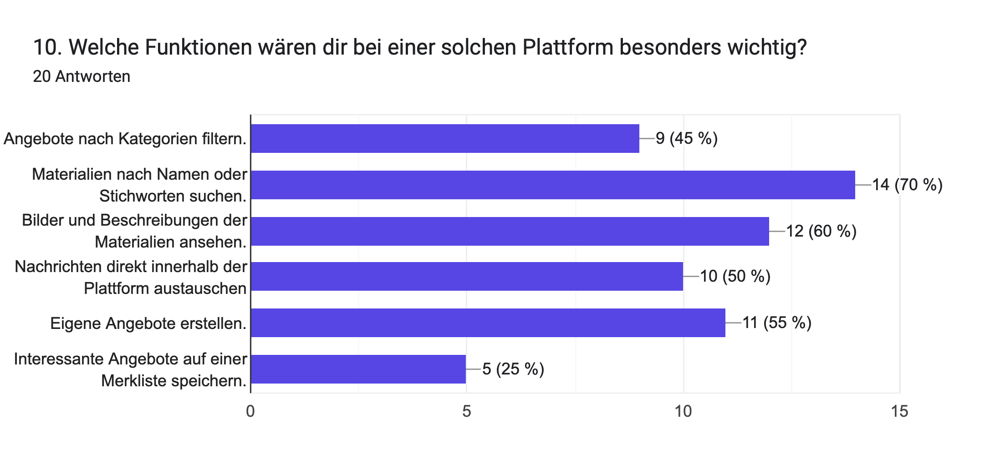
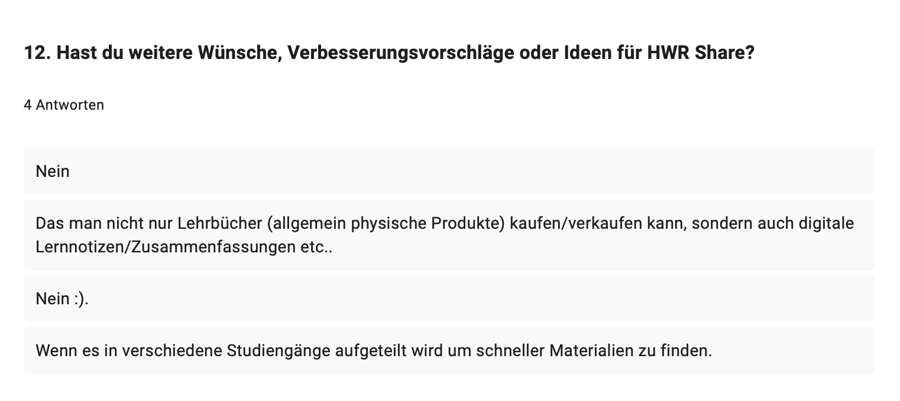

[← Product Discovery](README.md)

# Solution Elements – HWR Share

## Unser Lösungsansatz

HWR Share soll die zuvor identifizierten Probleme durch eine Webplattform zum Tauschen und kostenlosen Verschenken von Lernmaterialien lösen.

Dafür möchten wir Funktionen entwickeln, die das Finden, Anbieten und Weitergeben von Lernmaterialien möglichst einfach machen.

## Erkenntnisse aus unserer Umfrage

Um herauszufinden, welche Funktionen für die Studierenden besonders wichtig sind, haben wir in unserer Umfrage nach gewünschten Plattformfunktionen gefragt.

Bei dieser Frage haben 20 Personen geantwortet. Mehrfachantworten waren möglich.

Die Ergebnisse zeigen:

- **70 % (14 von 20)** wünschen sich eine Suchfunktion nach Stichwörtern oder Namen.
- **60 % (12 von 20)** finden Bilder und Beschreibungen der Materialien wichtig.
- **55 % (11 von 20)** wünschen sich die Möglichkeit, eigene Angebote zu erstellen.
- **50 % (10 von 20)** halten eine direkte Nachrichten- oder Chatfunktion für wichtig.
- **45 % (9 von 20)** wünschen sich eine Filterung nach Kategorien.
- **25 % (5 von 20)** wünschen sich eine Merkliste.

Diese Ergebnisse helfen uns dabei, die wichtigsten Funktionen für die erste Version von HWR Share auszuwählen.

## Geplante Funktionen

### 1. Lernmaterialien suchen und finden

Studierende sollen verfügbare Lernmaterialien auf einer übersichtlichen Seite ansehen können.

Geplante Funktionen:

- Anzeige aller verfügbaren Angebote.
- Suche nach Stichwörtern oder Materialnamen.
- Filterung nach Kategorien.
- Übersichtliche Darstellung der Angebote.

Dadurch sollen Studierende benötigte Materialien schneller und einfacher finden können.

### 2. Eigene Angebote erstellen und verwalten

Studierende sollen nicht mehr benötigte Lernmaterialien selbst anbieten können.

Dafür soll es ein Formular geben, in dem wichtige Informationen zum Material eingetragen werden.

Geplante Funktionen:

- Titel und Beschreibung eingeben.
- Kategorie auswählen.
- Festlegen, ob das Material getauscht oder verschenkt werden soll.
- Eigene Angebote bearbeiten oder löschen.

Dadurch können Materialien weitergegeben werden, die ansonsten möglicherweise ungenutzt bleiben würden.

### 3. Registrierung und Anmeldung

Für die Nutzung bestimmter Funktionen sollen Studierende ein Benutzerkonto erstellen können.

Geplante Funktionen:

- Registrierung.
- Anmeldung und Abmeldung.
- Eigenes Benutzerprofil.
- Übersicht der selbst erstellten Angebote.

So können Angebote den jeweiligen Benutzerkonten zugeordnet und von ihren Erstellern verwaltet werden.

### 4. Detailansicht der Angebote

Jedes Angebot soll eine eigene Detailseite erhalten.

Dort sollen die wichtigsten Informationen zum Lernmaterial angezeigt werden:

- Titel und Beschreibung.
- Kategorie.
- Art des Angebots: Tauschen oder Verschenken.
- Informationen zur anbietenden Person.
- Möglichkeit zur Kontaktaufnahme.

Dadurch können sich interessierte Studierende vor einer Kontaktaufnahme über das Material informieren.

### 5. Direkte Kommunikation über einen Chat

Studierende sollen über einen integrierten Chat miteinander kommunizieren können.

Dadurch können sie:

- Fragen zu einem Angebot stellen.
- Einen möglichen Tausch besprechen.
- Eine kostenlose Übergabe vereinbaren.

Die Chatfunktion soll die Kontaktaufnahme zwischen anbietenden und interessierten Studierenden erleichtern.

## Priorisierung der Funktionen

Für die erste Version von HWR Share möchten wir uns auf die grundlegenden Funktionen konzentrieren.

| Priorität | Funktion | Begründung |
|---|---|---|
| Hoch | Angebote anzeigen und suchen | Erleichtert das Finden von Lernmaterialien. |
| Hoch | Eigene Angebote erstellen | Ermöglicht das Weitergeben von Materialien. |
| Hoch | Angebote bearbeiten und löschen | Ermöglicht die Verwaltung eigener Angebote. |
| Hoch | Registrierung und Anmeldung | Ermöglicht persönliche Benutzerkonten. |
| Hoch | Detailansicht | Zeigt wichtige Informationen zu Angeboten. |
| Hoch | Chat | Ermöglicht die direkte Kontaktaufnahme. |
| Mittel | Kategorien und Filter | Erleichtert die Suche nach passenden Materialien. |
| Niedrig | Merkliste | Zusätzliche Funktion für eine spätere Version. |

Die Priorisierung berücksichtigt die Umfrageergebnisse und den begrenzten Umfang unseres Hochschulprojekts.

## Weitere Ideen aus der Umfrage

In einer offenen Frage konnten die Teilnehmenden zusätzliche Wünsche und Verbesserungsvorschläge nennen.

Dabei wurden unter anderem folgende Ideen vorgeschlagen:

- Digitale Lernnotizen und Zusammenfassungen anbieten.
- Lernmaterialien nach Studiengängen unterteilen, um passende Angebote schneller zu finden.

Diese Vorschläge können für eine spätere Erweiterung von HWR Share berücksichtigt werden.

Für die erste Version konzentrieren wir uns auf das Tauschen und kostenlose Verschenken von Lernmaterialien. Eine Kauf- oder Verkaufsfunktion ist zunächst nicht vorgesehen.

## Raw Material – Verwendete Materialien

Unsere Lösungsansätze basieren auf den Ergebnissen der anonymen Umfrage unter HWR-Studierenden.

### Frage 10 – Gewünschte Funktionen

Die Ergebnisse zeigen, welche Funktionen den befragten Studierenden besonders wichtig sind.

### Frage 12 – Weitere Wünsche und Verbesserungsvorschläge

Die offenen Antworten enthalten zusätzliche Ideen für mögliche Erweiterungen.

## Fazit

Die geplanten Funktionen von HWR Share orientieren sich an den Bedürfnissen der befragten Studierenden.

Im Mittelpunkt stehen das Suchen und Anbieten von Lernmaterialien sowie die direkte Kommunikation zwischen Studierenden.

Weitere Funktionen können später ergänzt werden, wenn sich bei der Entwicklung oder durch Nutzertests zusätzlicher Bedarf zeigt.
