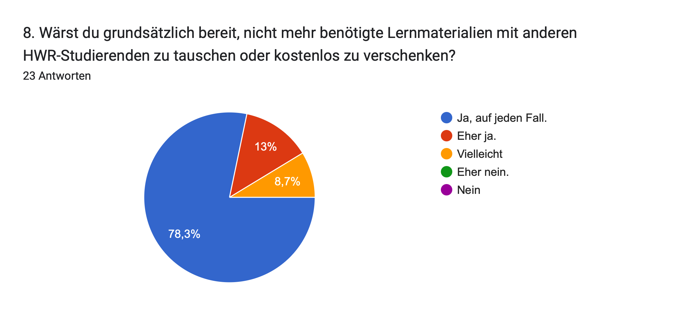
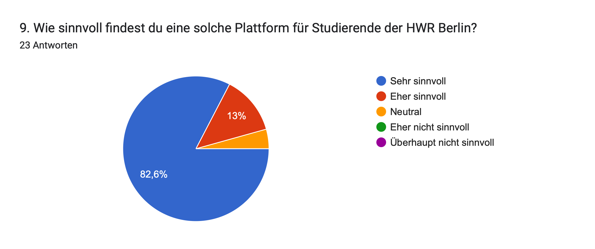
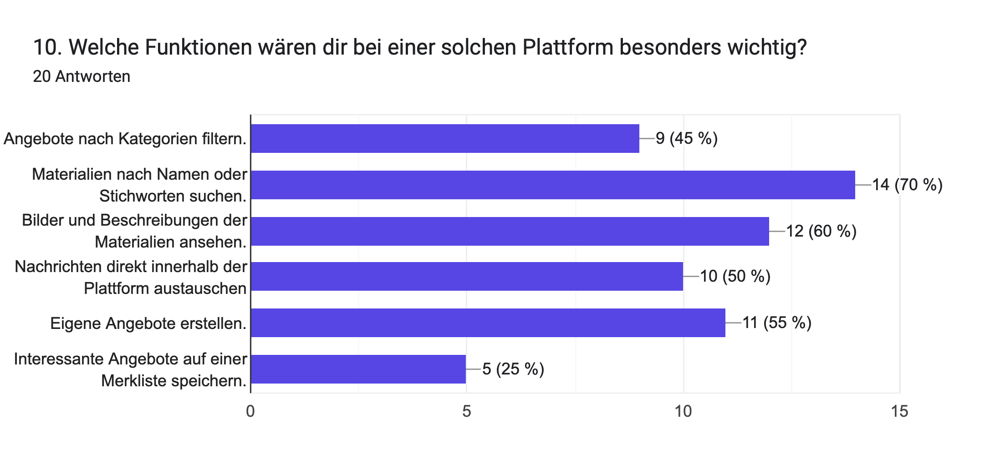
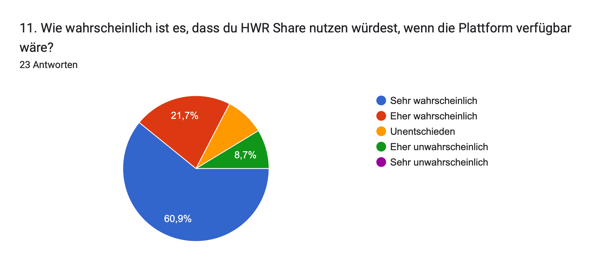

[← Product Discovery](README.md)

# Tests – HWR Share

## Ziel unserer Tests

Mit unseren Tests möchten wir überprüfen, ob HWR Share die Bedürfnisse der Studierenden erfüllt und ob die geplanten Funktionen verständlich und einfach zu bedienen sind.

Dabei möchten wir insbesondere herausfinden:

- Besteht Interesse an einer Plattform zum Tauschen und Verschenken von Lernmaterialien?
- Welche Funktionen sind den Studierenden besonders wichtig?
- Können Studierende Lernmaterialien einfach finden und anbieten?
- Ist die Kontaktaufnahme zwischen Studierenden verständlich und unkompliziert?

## 1. Durchgeführter Test – Online-Umfrage

### Ziel

Bevor wir mit der Entwicklung beginnen, wollten wir herausfinden, ob Studierende der HWR Berlin Schwierigkeiten bei der Beschaffung von Lernmaterialien haben und ob sie eine Plattform wie HWR Share nutzen würden.

### Durchführung

Wir haben eine anonyme Online-Umfrage mit Google Forms erstellt.

Die Umfrage bestand aus 12 Fragen zu folgenden Themen:

- Studienbereich und Fachsemester.
- Verwendung und Beschaffung von Lernmaterialien.
- Schwierigkeiten und Herausforderungen bei der Beschaffung.
- Umgang mit nicht mehr benötigten Materialien.
- Bereitschaft zum Tauschen oder Verschenken.
- Interesse an der Plattformidee.
- Gewünschte Funktionen und Verbesserungsvorschläge.

Je nach Frage liegen bis zu 24 Antworten vor.

### Ergebnisse

Die Umfrage lieferte folgende Erkenntnisse:

- **83,3 % (20 von 24)** haben häufig oder gelegentlich Schwierigkeiten, benötigte Lernmaterialien zu finden oder zu bekommen.
- **91,3 % (21 von 23)** wären grundsätzlich bereit, nicht mehr benötigte Lernmaterialien zu tauschen oder kostenlos zu verschenken.
- **95,7 % (22 von 23)** finden eine solche Plattform sehr oder eher sinnvoll.
- **82,6 % (19 von 23)** geben an, dass sie HWR Share sehr oder eher wahrscheinlich nutzen würden.

Außerdem wurden bei den gewünschten Funktionen besonders häufig eine Suchfunktion, Bilder und Beschreibungen, eigene Angebote sowie eine Chatfunktion ausgewählt.

### Auswertung

Die Ergebnisse zeigen, dass die befragten Studierenden grundsätzlich Interesse an unserer Plattformidee haben.

Besonders die hohe Bereitschaft zum Tauschen oder Verschenken unterstützt unseren Lösungsansatz.

Die Umfrage hat uns außerdem geholfen, wichtige Funktionen für die erste Version von HWR Share auszuwählen.

Allerdings ist die Anzahl der Teilnehmenden begrenzt. Die Ergebnisse sind daher nicht repräsentativ für alle HWR-Studierenden.

Außerdem bedeutet die angegebene Nutzungsbereitschaft nicht automatisch, dass die Studierenden die Plattform später tatsächlich verwenden werden.

## 2. Geplanter Test – Benutzerfreundlichkeit

Nach der Entwicklung einer ersten funktionsfähigen Version möchten wir HWR Share mit Studierenden testen.

### Ziel

Wir möchten überprüfen, ob die wichtigsten Funktionen verständlich sind und ohne größere Schwierigkeiten genutzt werden können.

### Geplante Durchführung

Wir möchten einige Studierende bitten, typische Aufgaben auf unserer Plattform auszuführen.

Dabei sollen sie möglichst selbstständig vorgehen.

### Testaufgaben

**Aufgabe 1 – Lernmaterial finden**

Die Testperson soll nach einem bestimmten Lernmaterial suchen und ein passendes Angebot öffnen.

Wir möchten überprüfen, ob die Suchfunktion und die Angebotsübersicht verständlich sind.

**Aufgabe 2 – Eigenes Angebot erstellen**

Die Testperson soll ein Lernmaterial zum Tauschen oder Verschenken anbieten.

Wir möchten überprüfen, ob das Formular verständlich ist und alle notwendigen Informationen einfach eingetragen werden können.

**Aufgabe 3 – Angebot bearbeiten oder löschen**

Die Testperson soll ein selbst erstelltes Angebot verändern oder entfernen.

Wir möchten überprüfen, ob die Verwaltung eigener Angebote einfach funktioniert.

**Aufgabe 4 – Kontakt aufnehmen**

Die Testperson soll ein Angebot öffnen und über den Chat eine Nachricht an die anbietende Person senden.

Wir möchten überprüfen, ob die Kontaktaufnahme verständlich und unkompliziert ist.

## 3. Geplante Auswertung der Benutzertests

Während der Tests möchten wir beobachten:

- Können die Testpersonen die Aufgaben erfolgreich abschließen?
- Bei welchen Schritten treten Schwierigkeiten auf?
- Welche Funktionen sind möglicherweise unverständlich?
- Welche Verbesserungsvorschläge nennen die Testpersonen?

Nach den Tests möchten wir die Rückmeldungen sammeln und auswerten.

Falls Probleme auftreten, sollen diese nach Möglichkeit bei der weiteren Entwicklung berücksichtigt werden.

## Raw Material – Verwendete Materialien

### Bereits durchgeführte Umfrage

Als Nachweis für unseren ersten Test verwenden wir die Ergebnisse der anonymen Online-Umfrage.

**Frage 8 – Bereitschaft zum Tauschen oder Verschenken**

**Frage 9 – Bewertung der Plattformidee**

**Frage 10 – Gewünschte Funktionen**

**Frage 11 – Wahrscheinlichkeit der Nutzung**

### Geplante Benutzertests

Die Ergebnisse der späteren Benutzertests werden nach der Durchführung ergänzt.

Dazu möchten wir die verwendeten Testaufgaben, Beobachtungen und wichtigsten Rückmeldungen dokumentieren.

## Fazit

Unsere Online-Umfrage war ein erster Test der Projektidee und hat gezeigt, dass unter den befragten Studierenden Interesse an HWR Share besteht.

Die Ergebnisse unterstützen die Auswahl unserer geplanten Funktionen.

Ob die Plattform tatsächlich einfach zu bedienen ist und die Bedürfnisse der Studierenden erfüllt, möchten wir nach der Entwicklung durch praktische Benutzertests überprüfen.
